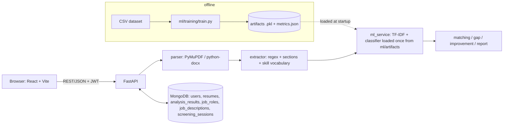

# AI Resume Screening & Job Role Prediction System

A full-stack Machine Learning laboratory project: upload PDF/DOCX resumes, extract structured information, predict the best-fit job role with a trained TF-IDF classifier, score a resume against a job description, rank many candidates, find skill gaps and get improvement advice - with MongoDB persistence, JWT authentication and PDF reports.

**Stack:** React + Vite + Tailwind + Framer Motion + Recharts · FastAPI · scikit-learn (TF-IDF, Logistic Regression, Random Forest, linear SVM) · PyMuPDF / python-docx · MongoDB · ReportLab. No paid APIs.

> ## Read this first - honest status
> * **Dataset:** the build environment had no internet, so **no real resume dataset is bundled.** A clearly-labelled **synthetic** dataset (`ml/datasets/resume_dataset_synthetic.csv`, 750 template-generated resumes) is included so everything runs end-to-end. Metrics from it (about 97% accuracy) only show the pipeline works - they say **nothing** about real-world accuracy. The app shows a "demo model" banner while a synthetic model is loaded. For your lab submission, download a real dataset and retrain (see `ml/datasets/README.md`; one command).
> * **What was actually run and passed in the build environment:** dataset generation, preprocessing, training/evaluation of all 3 models, artifact saving, resume parsing (DOCX), information extraction, ML inference + explanation, matching, skill-gap, resume review, PDF report generation (15 unit tests, `python -m unittest discover -s tests -t .`), and a syntax + module-resolution build check of every React file.
> * **Not run in the build environment** (packages could not be installed): the FastAPI server, MongoDB, the PDF-parsing path (PyMuPDF), `npm install`/`vite`, and the browser UI. That code was written carefully and statically checked, and `tests/backend/test_api.py` exercises the whole HTTP flow, but **expect to fix small integration issues on your first run** and run that test (`python -m unittest tests.backend.test_api -v`) after installing requirements.
> * Tailwind/Vite/React UI has not been viewed in a browser; layout polish may need tweaks.

## Quick start (Windows)

Prerequisites: Python 3.10-3.12, Node.js 18+, and either a local MongoDB / MongoDB Atlas **or** nothing (use the in-memory demo DB).

```bat
setup.bat            :: venv + pip install + generates synthetic data + trains models + npm install
notepad .env         :: set SECRET_KEY; MONGO_URI=mongomock for a zero-install demo DB (data is lost on restart)
run_backend.bat      :: http://localhost:8000  (docs at /docs)
run_frontend.bat     :: http://localhost:5173
```

Manual equivalent (macOS/Linux): `python -m venv venv && source venv/bin/activate && pip install -r requirements.txt`, then `python -m ml.datasets.generate_synthetic_dataset && python -m ml.training.train`, `cd backend && uvicorn app.main:app --reload --port 8000`, and `cd frontend && npm install && npm run dev`.

Train on real data: `train_model.bat "C:\path\Resume.csv"` (or `python -m ml.training.train --data ... [--map-to-supported]`), then restart the backend.

## Features -> where they live

| Requirement | Implementation |
|---|---|
| Landing page, protected app, light SaaS theme (navy `#14213D`, blue `#2563EB`) | `frontend/src/pages/Landing.jsx`, `layouts/AppLayout.jsx`, `tailwind.config.js` |
| Real auth (register/login, bcrypt-class hashing, JWT, remember me, forgot/reset) | `backend/app/api/auth.py`, `utils/security.py`, `pages/AuthPage.jsx` |
| Upload (drag-drop, multi, validation, progress, text preview) | `components/Dropzone.jsx`, `pages/Analyze.jsx`, `services/parser.py` |
| Info extraction (name, email, phone, education, skills, experience, projects, certifications, summary; "Not detected" if absent) | `services/extractor.py` |
| Job-role prediction (top-1 + 3 alternatives, probability, supporting/missing skills, explanation) | `services/ml_service.py`, `components/AnalysisView.jsx` |
| JD matching (TF-IDF cosine + skill overlap + experience evidence + education) | `services/matching.py`, `pages/JobMatch.jsx` |
| Ranking (sort, filter, CSV export, failures listed) | `api/screening.py`, `pages/Ranking.jsx` |
| Skill gap + dynamic roadmap + projects | `services/gap.py`, `pages/SkillGap.jsx` |
| Resume improvement (rule-based, no invented content) | `services/improvement.py`, `pages/Improve.jsx` |
| History: view, compare two, delete, PDF | `api/history.py`, `pages/History*.jsx`, `services/report.py` |
| Dashboard from real DB records | `GET /api/dashboard/stats`, `pages/Dashboard.jsx` |
| ML pipeline (preprocess, TF-IDF 1-2 grams, LR/RF/SVM, 80/20 stratified, CV, metrics, joblib) | `ml/` |
| 3D micro-interactions | CSS 3D floating resume, tilt card, particles, scan line, progress rings, skill-node graph; all respect `prefers-reduced-motion`. Pure CSS/SVG - no WebGL, so no fallback is needed. |

## Architecture



**Data flow:** file bytes (never written to disk) -> validation (extension, size, magic bytes) -> text -> `extract_info` -> `clean_text` -> TF-IDF -> classifier -> `{role, probability, top terms}`; matching reuses the same fitted vectorizer for cosine similarity. Results are stored in `analysis_results`; the raw text lives in `resumes` with a TTL index (auto-deleted after `RESUME_RETENTION_DAYS`).

**Workflow:** upload -> extract -> analyze -> (match | gap | improve) -> history/report.

## Matching score (transparent)

`overall = weighted mean` of: skills coverage (50%) · TF-IDF cosine similarity to the JD (20%, scaled so cosine 0.35 = full; heuristic) · experience relevance (20%: years vs JD requirement and whether matched skills appear in experience/projects) · education relevance (10%, only if the JD states a degree). Components without data are dropped and weights renormalised. It is an *estimated text-based compatibility measure, not a hiring decision*. The classifier probability is likewise *not* an employability probability; both statements are shown in the UI and PDF.

## Fairness & privacy

No extraction or use of age, gender, religion, caste, photos, disability or other protected traits; contact details are stripped before vectorising. (Names are not used by the model, but text can still carry demographic proxies - see limitations.) Resumes are processed in memory, raw text auto-expires, deleting a history item deletes its resume text, results are isolated per user, passwords use salted PBKDF2-SHA256 (240k iterations), JWTs are signed, login attempts are throttled, secrets come from `.env`.

## API

All routes are under `/api`; except `auth/*`, `meta/*`, `ml/metrics` and `health`, they require `Authorization: Bearer <token>`. Interactive docs: `http://localhost:8000/docs`.

| Method & path | Body | Returns |
|---|---|---|
| `POST /auth/register` · `/auth/login` | `{name,email,password}` · `{email,password,remember}` | `{access_token, user}` |
| `GET /auth/me`, `POST /auth/forgot-password`, `/auth/reset-password` | - | reset link is printed in the backend console (no SMTP bundled) |
| `POST /resume/upload` | multipart `files[]` | `{resumes:[{resume_id, filename, size, text_preview, info}], errors}` |
| `POST /resume/analyze` | `{resume_id, job_role?}` | analysis document (info, prediction, review) |
| `POST /predict/job-role` | `{resume_id}` | `{analysis_id, prediction}` |
| `POST /match/job-description` | `{resume_id, job_role, job_description, required_skills[]}` | `{analysis_id, match}` |
| `POST /screening/rank` | multipart `files[]`, `job_description`, `required_skills` (comma list), `job_role` | `{session_id, ranked[], failed[], fairness_note}` |
| `POST /skills/gap-analysis` | `{resume_id, job_role}` | `{analysis_id, gap}` |
| `POST /resume/improve` | `{resume_id, job_role?}` | `{analysis_id, review, target_role}` |
| `GET /dashboard/stats` | - | aggregates computed from stored analyses |
| `GET /history` · `GET/DELETE /history/{id}` | - | summaries · full analysis · `{deleted:true}` |
| `GET /report/{id}` | - | PDF |
| `GET /meta/roles` · `GET /ml/metrics` · `GET /health` | - | public |

## Project layout

```
backend/app/   api/ (routers) services/ (parser, extractor, ml, matching, gap, improvement, report) database/ schemas/ utils/ main.py
frontend/src/  pages/ components/ layouts/ services/ hooks/ utils/
ml/            datasets/ preprocessing/ training/ evaluation/ artifacts/ (generated)
docs/          ML_DOCUMENTATION.md, ML_RESULTS.md (generated from the actual training run)
tests/         backend/ ml/ frontend/ (see Testing)
reports/sample_reports/sample_analysis_report.pdf
```

## Testing

`python -m unittest discover -s tests -t .` runs the ML, service and (if dependencies and artifacts exist) HTTP end-to-end tests. There are no automated frontend tests; use this manual checklist: navigation and protected routes, signup/login/validation/show-password/remember-me, upload (wrong type, >5 MB, multiple files), analyze, match, ranking sort/filter/CSV, gap, improve, history compare/delete/PDF, mobile width (sidebar drawer), and OS "reduce motion" setting.

## Limitations

Extraction is rule-based and tuned to conventional section headings; flattened or heavily designed resumes (and scanned PDFs - no OCR) yield less. The skill vocabulary has 97 skills; unknown skills are not detected. Rule-based review scores are heuristics. Classifiers trained on public datasets inherit their label noise and demographic biases. Forgot-password only logs the link. In-memory login throttling resets on restart. The synthetic dataset is not a substitute for real data. Full ML write-up: `docs/ML_DOCUMENTATION.md`.
